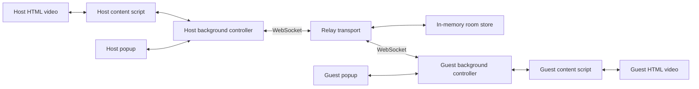

# Architecture

The browser extension owns player access and synchronization. The relay owns room membership and the authoritative host playback state. It never fetches or forwards the stream.

## Module boundaries

| Module | Responsibility |
| --- | --- |
| `server/index.js` | Process startup, logging, signals, exit status |
| `server/config.js` | Parse and validate environment configuration |
| `server/relay.js` | HTTP routes, WebSocket admission, message parsing, traffic limits, heartbeat, shutdown |
| `server/transport.js` | Bounded outgoing queues and failed-write handling |
| `server/rooms.js` | Room creation/joining, host authorization, resume credentials, presence, disconnect expiry |
| `server/protocol.js` | Playback validation, projected position, accepted browser origins |
| `extension/background/index.js` | Start the browser worker |
| `extension/background/controller.js` | Room session, reconnects, clock offset, frame selection, browser events |
| `extension/background/validation.js` | Validate relay addresses |
| `extension/content/index.js` | Discover HTML videos, publish host state, apply guest state, show autoplay controls |
| `extension/popup/` | Create/join forms, connection status, tab focus, explicit player permission requests |

`createRelay()` owns a transport and a room store; constructing it does not bind a port. Tests can listen on an ephemeral port and call its idempotent `close()`. The room store accepts a send function so its rules do not depend on a WebSocket server implementation.

`createBackground()` receives browser APIs, WebSocket, and timer functions. Tests instantiate the controller directly with simulated browser APIs. The worker entrypoint stays small. Content scripts remain classic scripts because the manifest and programmatic injection use that format; the popup is plain HTML/CSS/JavaScript. There is no bundler or framework.

## Room and playback lifecycle

1. A popup chooses a NetMirror tab and sends `ui-start` to its background controller.
2. The controller validates the relay URL, opens a socket, and sends `create` or `join`.
3. The relay returns `welcome` with the room code, private member token, role, latest state, and server timestamp. Each room has one host.
4. Content scripts in authorized frames report video presence and a visibility/playback score. The controller selects one player frame.
5. Only the host's selected frame publishes playback state. The room store validates it, adds the server timestamp, and broadcasts it.
6. Guests project position using elapsed time and playback speed. Ping/pong timing estimates the server clock offset. Drift above roughly 0.8 seconds triggers correction.
7. Host disconnect pauses the shared state. Members can resume with their private token for 45 seconds. Host expiry, host tab closure, or deliberate host leave ends the room.

Room codes are invitations. Member tokens authorize resuming an existing member and must not be shared. Tokens live in extension session storage, or background memory if that API is unavailable. A browser/extension restart may require a new party. Relay memory is the only room store.

## Wire protocol

Messages are JSON objects on the root WebSocket endpoint `/`.

| Direction | Type | Important fields |
| --- | --- | --- |
| Client → relay | `create` | None |
| Client → relay | `join` | `code` |
| Client → relay | `resume` | `code`, `token` |
| Host → relay | `state` | `state: {position, paused, rate, duration}` |
| Client → relay | `ping` | `sentAt` |
| Client → relay | `leave` | None |
| Relay → client | `welcome` | `code`, `token`, `role`, `state`, `serverTime` |
| Relay → client | `state` | State plus `updatedAt` |
| Relay → client | `presence` | `members`, `hostOnline` |
| Relay → client | `pong` | `sentAt`, `serverTime` |
| Relay → client | `heartbeat` | `serverTime` |
| Relay → client | `error`, `ended` | Human-readable `message` |

Positions/durations are seconds, timestamps are Unix milliseconds, and rates range from 0.25 to 4. Each connection allows up to 100 messages per 10-second window and payloads up to 8 KiB. Unjoined connections have a 10-second admission timeout. Connection count defaults to 2000; slow peers are disconnected before their send queues exceed 256 KiB. Room codes, resume tokens, and ping timestamps are validated without coercing arbitrary objects. WebSocket ping/pong and application heartbeats detect lost peers and keep active extension workers alive.

## Extension trust and permissions

Popup operations are accepted from extension pages only. Content scripts can report video state for their own party tab; guest controls are never forwarded as authoritative host updates. The extension requests access to embedded sites only after the user presses the permission button.

The relay accepts Chromium/Safari extension origins and originless native clients. This filters ordinary website connections but does not authenticate a client. It has no account system or deployment admission password.

## Verification boundaries

Node tests exercise the real relay protocol and simulated browser/media behavior. Deployment smoke tests use actual WebSockets against a running service. Browser permissions, site verification pages, changing iframe domains, protected media, and autoplay policies still require manual browser checks. These boundaries are described in the troubleshooting and deployment guides.
